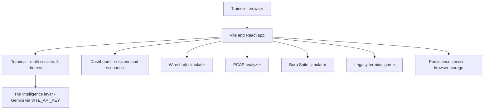
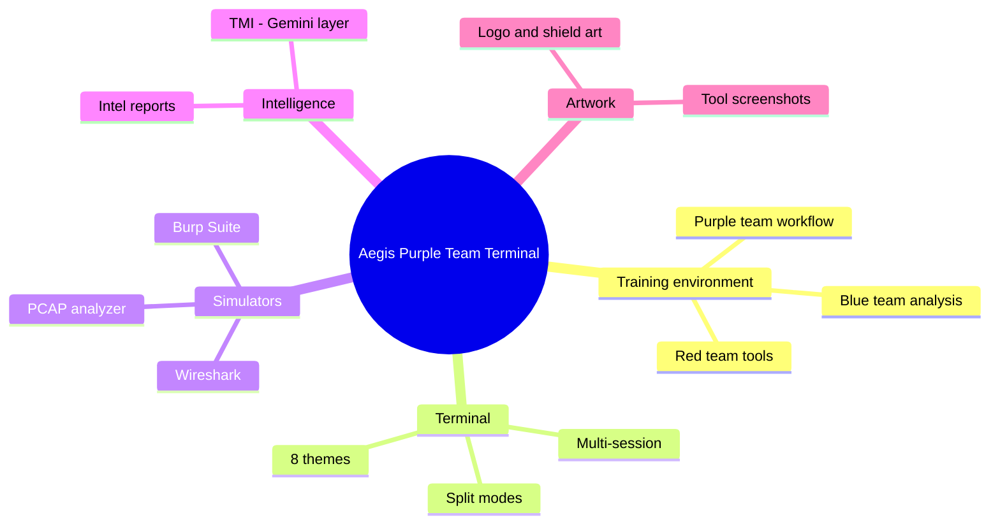
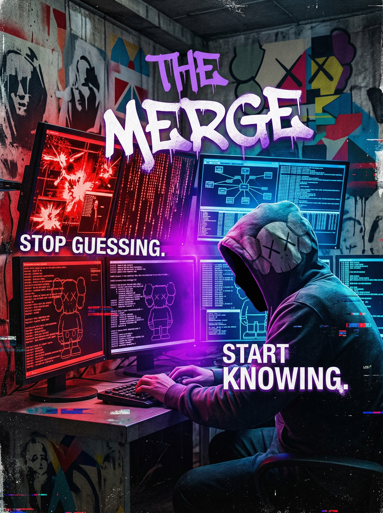
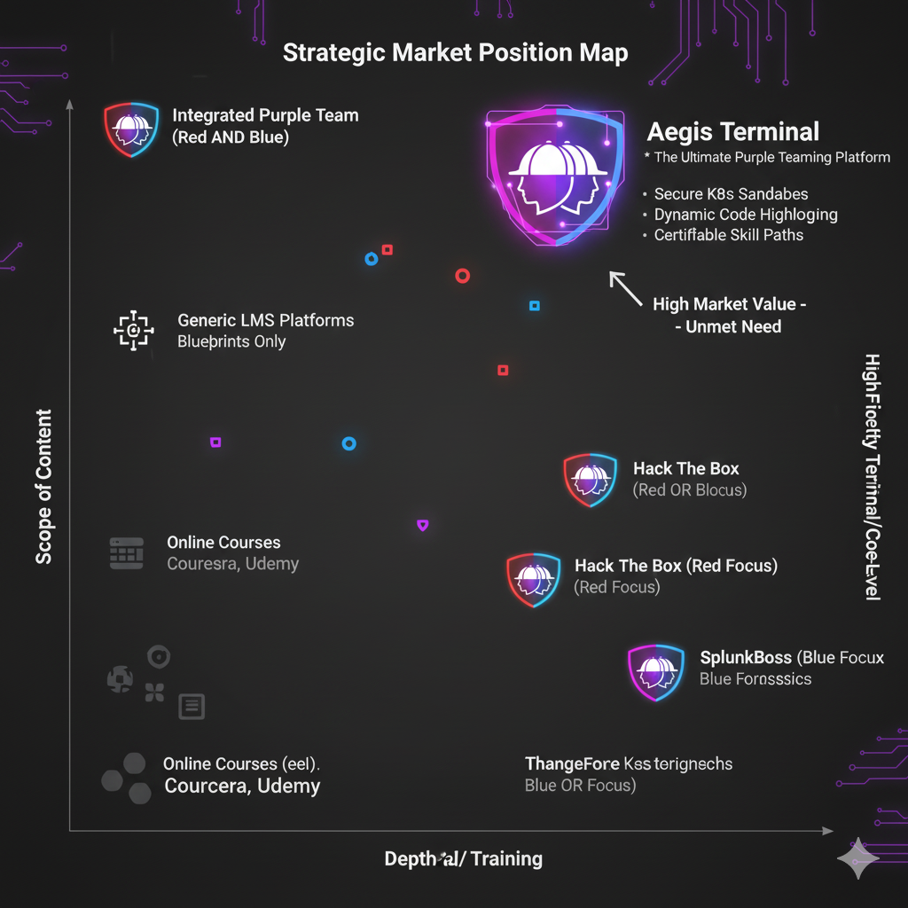
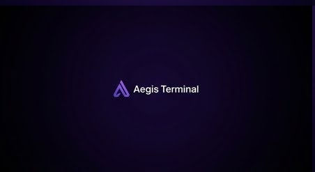

# Aegis Purple Team Terminal

<p align="center"></p>

_The logo file itself (`public/assets/aegis-logo.png`) is a binary upload still pending placement in `public/assets/`; the banner above is artwork already in this repository._

A browser-based purple-team training terminal: a simulated security operations environment where red-team tools meet blue-team analysis — an interactive terminal, a dashboard, and working simulators for packet analysis and web proxy work, with a Gemini-powered intelligence layer ("TMI").

## What's inside

- **Terminal** (`src/components/Terminal.tsx`) — multi-session terminal with split modes (horizontal/vertical), 8 themes (aegis, cyber, matrix, ghost, nord, dracula, solarized, crimson), banners, intel reports, and TMI log/suggestion lines
- **Dashboard** (`src/components/Dashboard.tsx`) — session and scenario overview
- **Wireshark simulator** (`src/components/WiresharkSim.tsx`) and **PCAP analyzer** (`src/components/PcapAnalyzer.tsx`) — packet-capture style analysis practice
- **Burp Suite simulator** (`src/components/BurpSuiteSim.tsx`) — web proxy / request inspection practice
- **Scenarios & persistence** — scenario definitions in `src/types.ts`, local persistence in `src/services/persistenceService.ts` (the old `firebaseService.ts` is deprecated and kept as a stub)
- **TMI intelligence** (`src/services/geminiService.ts`) — optional Gemini integration via `@google/genai`; without a key the terminal runs fully, with the uplink disabled
- **Legacy mini-game** (`src/legacy/AegisTermGame.tsx`)

## Tech stack

- Vite 6 + React 19 + TypeScript
- `@google/genai`, Firebase 12 (dependency present; live service layer is local persistence)
- Deploys as a static Vite build (`vercel.json` included: `npm run build` → `dist/`)

## Run locally

Prerequisites: Node.js

```bash
npm install
cp .env.example .env.local   # optional: set VITE_API_KEY for the Gemini features
npm run dev
```

Originally built in Google AI Studio: https://ai.studio/apps/drive/1dmWFBV9w9c3K5RUVhQ1PlDg5bdAVfvJs

## Environment variables

| Variable | Required | Notes |
| --- | --- | --- |
| `VITE_API_KEY` | No | Gemini API key for TMI intelligence features. (The AI Studio template README called this `GEMINI_API_KEY`; the code reads `VITE_API_KEY`.) |

## Asset note

The app references 8 images in `public/assets/` (promo art and tool screenshots, ~7 MB total: aegis-promo.png, cyber-merger.jpeg, market-map.png, cli-terminal.png, tool3-recon.png, tool4-wireshark.png, tool5-terminal.png, aegis-glitch.jpeg).

Brand artwork (added 2026-11-13, in `public/assets/`):

| File | What it is |
| --- | --- |
| `aegis-logo.png` | App logo — split red/blue shield with dual hard-hat profiles and terminal prompt |
| `aegis-shield-art.jpg` | Street-art style shield illustration with red/blue security iconography |
| `aegis-red-blue-infinity.jpg` | Red Team / Blue Team infinity poster ("Offense Mastery" / "Detection Skills") |

## Visual overview

### Project layout



### Mindmap



### Screenshots and artwork

The artwork below is already in this repository under `src/public/assets/` (uploaded directly; the app itself serves assets from `public/assets/`, so these files are the gallery copies until they are also placed there).

<p align="center"></p>

<p align="center"></p>

<p align="center"></p>

<p align="center"></p>

<p align="center"></p>

<p align="center"></p>


## Repository notes

| Date | Change |
| --- | --- |
| 2026-11-25 | Added `wrangler.json` with a Cloudflare R2 bucket binding (`R2` → bucket `my-bucket`), then removed it the same day at Cecil's direction — the bucket plan was cancelled. The app continues to deploy as a static Vite build on Vercel (`vercel.json`). |
